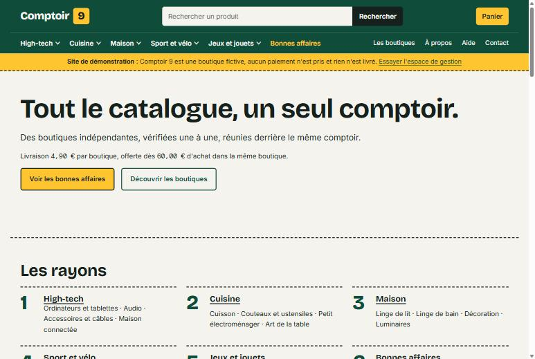
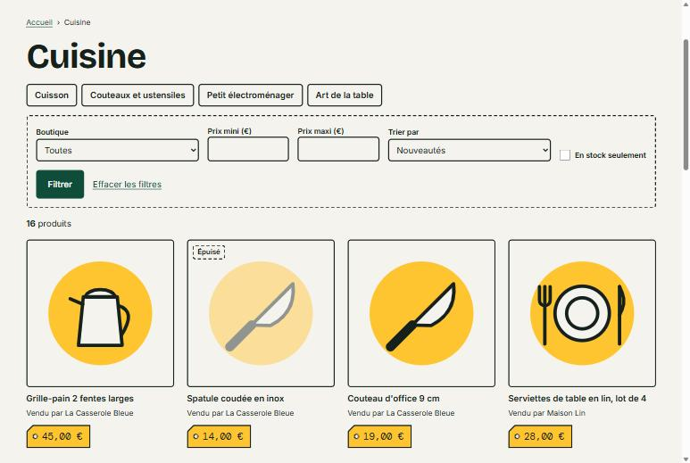
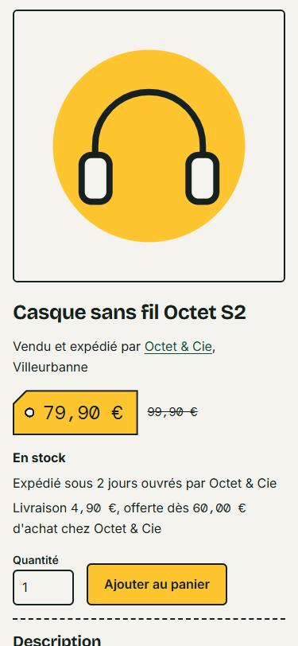
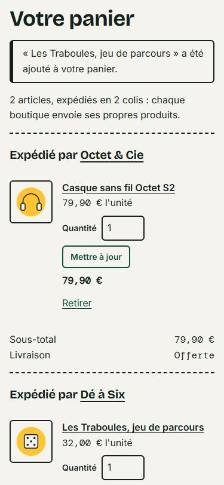
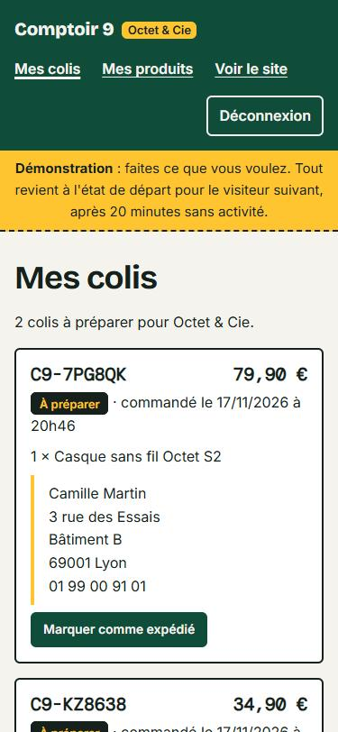

# Comptoir 9

**Place de marché fictive : plusieurs boutiques indépendantes, un seul panier, et un espace de gestion à essayer soi-même.**
PHP 8 et MySQL, sans framework · Projet de portfolio de Ricardo Remond

**[Voir le site en ligne →](https://comptoir9.alwaysdata.net)** · **[Essayer l'espace de gestion →](https://comptoir9.alwaysdata.net/admin/connexion.php)** (sans mot de passe)

> « Tout le catalogue, un seul comptoir. »
> Cinq boutiques indépendantes (high-tech, cuisine, maison, vélo, jeux) vendent leurs produits neufs
> derrière le même comptoir, à Lyon. L'entreprise, les boutiques, les personnes et les produits sont inventés.



| Catalogue avec filtres | Fiche produit (mobile) |
|---|---|
|  |  |

| Panier à deux boutiques (mobile) | Espace vendeur en démonstration (mobile) |
|---|---|
|  |  |

---

## Ce que fait le site

- **Une place de marché multi-vendeurs** : 240 produits, 5 rayons et 20 sous-rayons, recherche,
  filtres (boutique, prix, en stock), tri et pagination. Tout passe par l'adresse : une recherche
  se met en favori, et **le site marche sans JavaScript**.
- **Un seul panier pour toutes les boutiques**, découpé en **un colis par boutique**, chacun avec ses
  frais de port (offerts dès 60 € dans la même boutique) et son délai d'expédition.
- **Une commande sans compte** : coordonnées, récapitulatif, numéro de commande tiré au hasard
  (`C9-7K4M2X`), ticket de confirmation imprimable, et **suivi colis par colis** avec le numéro et l'e-mail.
  Le paiement est simulé.
- **Un espace de gestion à deux rôles** :
  - **l'administration** voit toutes les commandes et les messages, suspend une boutique, masque un produit ;
  - **chaque vendeur** ne voit que ses colis (à expédier, avec l'adresse) et ses produits (prix, stock, mise en vente).
- **Une démonstration ouverte aux visiteurs** : deux boutons sur la page de connexion ouvrent l'espace
  sans mot de passe, en admin ou en boutique. Chaque nouveau visiteur retrouve le même tableau de bord
  (2 commandes à expédier, 2 parties, 3 messages) : les données reviennent à leur état de départ quand
  le visiteur précédent s'est déconnecté, ou après 20 minutes sans activité.
- **Une identité de comptoir de magasin** : papier clair, vert sapin et jaune étiquette, prix en police
  de ticket de caisse, filets pointillés, et 20 illustrations SVG (une par sous-rayon) dessinées par un script.

## Choix techniques

- **PHP 8 et MySQL sans framework** : includes réutilisables, PDO avec de vraies requêtes préparées,
  tout le SQL d'un usage regroupé dans un seul fichier (`includes/donnees/catalogue.php`,
  `includes/commande.php`, `includes/admin/vendeur.php`…).
- **Prix en centimes** (entiers) de la base à l'affichage : aucune erreur d'arrondi.
- **Commande en transaction** : produits relus et verrouillés (`SELECT … FOR UPDATE`), commande refusée
  si un prix ou un stock a changé depuis le récapitulatif, nom et prix copiés dans la commande.
- **Référencement** : plan du site (`/sitemap.xml`) et `robots.txt` fabriqués depuis la base ;
  données structurées `Organization`, `Product` (prix, disponibilité) et `BreadcrumbList` ; Open Graph.
- **Le site public ne dépose aucun cookie** tant qu'on ne remplit pas de panier : pas de bandeau de
  consentement (le cookie de panier est dispensé de consentement selon la CNIL).
- **Pas de dépendance** : ni Composer, ni npm, ni outil d'assemblage. Polices hébergées sur le site.
- **Indépendant de l'hébergeur** : adresse du site, base, clé secrète et hébergeur des mentions légales
  sont dans `config/config.local.php`, hors du code.

## Sécurité

- **Requêtes préparées** partout (`ATTR_EMULATE_PREPARES` à `false`), **échappement** de chaque affichage
  (`e()`), **CSP** stricte : aucun script, style ou police extérieur.
- **Panier et commande** : jeton de session sur chaque action, contrôle de l'origine de la requête,
  cookie `HttpOnly` et `SameSite=Lax` déposé au premier ajout seulement ; le dernier exemplaire d'un
  produit ne se vend qu'une fois (vérifié avec quatre commandes envoyées en même temps).
- **Formulaire de contact sans cookie** : champ piège, jeton signé (HMAC) contenant l'heure d'affichage
  (accepté entre 3 s et 2 h), 10 messages par heure pour le site.
- **Cloisonnement des vendeurs** : chaque requête de l'espace vendeur filtre sur la boutique du compte
  connecté, relue en base ; un identifiant de colis ou de produit venu d'un formulaire n'est jamais cru seul.
- **Espace de gestion** :
  - mots de passe hachés (`password_hash`), comptes créés en ligne de commande, sans page d'inscription ;
  - cookie limité à `/admin/`, `HttpOnly`, `SameSite=Strict`, `Secure` en ligne ;
  - identifiant de session renouvelé à la connexion, déconnexion après 2 h d'inactivité,
    rôle relu en base à chaque page (un compte supprimé perd aussitôt sa session) ;
  - jeton CSRF sur chaque action, connexion et déconnexion comprises ;
  - blocage de 15 minutes après 5 échecs, comptés par MySQL ;
  - comptes de démonstration impossibles à ouvrir par le formulaire, et sans droit de changer
    les textes affichés sur le site public.
- **En ligne** : HTTPS forcé, en-têtes de sécurité, version de PHP non annoncée, dossiers internes
  inaccessibles (404), erreurs PHP jamais affichées (page 503 sobre si la base ne répond pas).
- **RGPD** : seulement les données utiles, pas d'adresse IP enregistrée ; commandes et messages
  supprimés automatiquement après 30 jours.

## Qualité vérifiée

| Contrôle | Résultat |
|---|---|
| `tests/securite.php` | 143 vérifications sur le site en ligne (141 en local, sans HTTPS), vu de l'extérieur : pages sans cookie, en-têtes, HTTPS, dossiers internes, saisies piégées, CSRF, sessions, rôles, cloisonnement des vendeurs, démonstration, 280 adresses du plan du site |
| `tests/catalogue.php` | 70 vérifications : rayons, recherche, filtres, tri, pagination, visibilité, droits de l'utilisateur MySQL |
| `tests/commande.php` | 60 vérifications : frais de port, découpage en colis, stocks, dernier exemplaire, suivi |
| `tests/helpers.php` | 26 vérifications : prix, échappement, images, données structurées |
| Lighthouse 13.6 (mobile) | 100 / 100 / 100 / 100 (performance, accessibilité, bonnes pratiques, référencement) sur l'accueil, un rayon et une fiche produit ; affichage principal en 0,8 à 0,9 s en 4G lente, aucun décalage de mise en page |
| Lighthouse 13.6 (ordinateur) | 100 / 100 / 100 / 100 sur l'accueil |
| Validateur HTML du W3C | 0 erreur sur l'accueil, un rayon, une fiche produit, le contact et la connexion à la gestion |
| Test des résultats enrichis de Google | fiche produit : extrait de produit, fiche de marchand et fil d'Ariane valides ; `Organization` sans erreur (validator.schema.org) |

Mesures faites sur le site en ligne le 18 novembre 2026 (un passage par page : les notes Lighthouse
varient un peu d'un passage à l'autre). Chaque fichier de test commence par un cas volontairement faux, qu'il doit refuser.

## Démarche

Le projet a avancé en huit phases, chacune validée avant la suivante : fondations, composants, pages
statiques, base de données et catalogue, panier et commande, finitions, espace de gestion (avec la
démonstration), puis mise en ligne. L'historique Git suit ces étapes.

---

## Installer le projet en local

**Prérequis** : [Laragon](https://laragon.org/) (Apache, PHP 8.1+, MySQL), ou tout serveur
Apache avec PHP 8.1+ (extensions `intl`, `mbstring`, `pdo_mysql`) et MySQL 8 ou MariaDB.

1. Placer le projet dans `C:\laragon\www\comptoir-9`, puis cliquer sur **Recharger** dans Laragon :
   le site est servi sur `http://comptoir-9.test`.
2. Base de données, en `root` :
   - mettre un mot de passe à la place de `CHANGER_CE_MOT_DE_PASSE` dans `sql/creation-base.sql`,
     puis exécuter ce fichier (base et utilisateur dédié) ;
   - exécuter `sql/schema.sql`, puis `sql/seed.sql`, puis `sql/produits-supplementaires.sql`
     (160 produits de plus ; ce dernier fichier ne fait qu'ajouter et peut être relancé sans danger).
3. Copier `config/config.example.php` en `config/config.local.php` et y mettre l'adresse du site,
   le même mot de passe et une clé secrète aléatoire (`php -r "echo bin2hex(random_bytes(32));"`).
   Ce fichier est exclu de Git.
4. Remplir la démonstration : `php outils/reinitialiser-demo.php`.
5. Facultatif, un vrai compte de gestion : `php outils/creer-compte.php <identifiant> --admin`
   (ou `--boutique=<slug>` pour un vendeur). Le mot de passe se tape sans s'afficher.

**Attention** : `sql/schema.sql` supprime toutes les tables, commandes et comptes compris.
Ne jamais le lancer sur le site en ligne.

**Tests**, MySQL démarré : `php tests/helpers.php`, `php tests/catalogue.php`, `php tests/commande.php`
et `php tests/securite.php` (ce dernier interroge l'adresse de `config.local.php`).

## Structure

```
comptoir-9/
├── *.php          pages publiques (accueil, catalogue, produit, boutiques, panier, commande, suivi, contact…)
├── admin/         espace de gestion (admin et vendeurs, démonstration)
├── includes/      morceaux de page, connexion, panier, commande, contact, démo, requêtes, admin
├── config/        configuration (site.php versionné ; config.local.php exclu de Git)
├── sql/           création de la base, tables, données de départ
├── outils/        scripts en ligne de commande (comptes, démonstration, illustrations)
├── tests/         tests en ligne de commande
├── assets/        CSS, JavaScript, polices (.woff2 et licences), images et illustrations
└── docs/captures/ captures d'écran de ce README
```

## Crédits

- Polices : Bricolage Grotesque, Inter et DM Mono (SIL Open Font License 1.1) ;
  textes des licences dans `assets/fonts/licences/`.
- Illustrations : dessinées en SVG par `outils/dessiner-illustrations.php`, aucune image extérieure.
